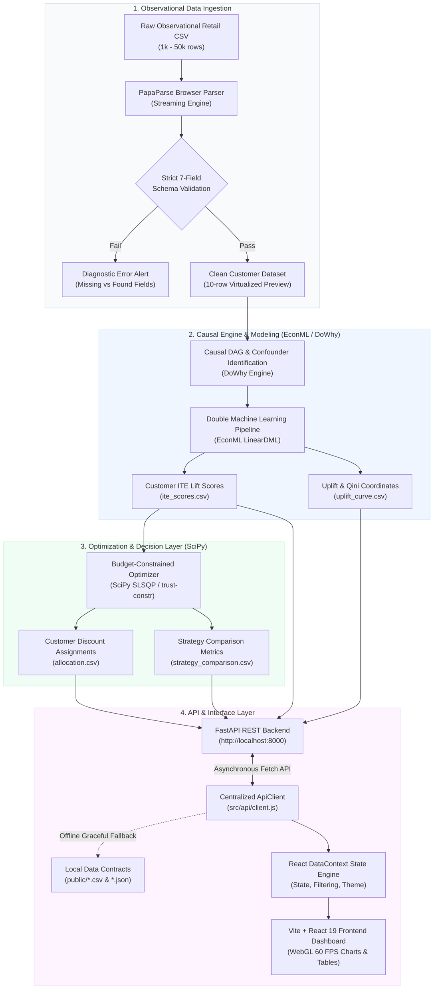
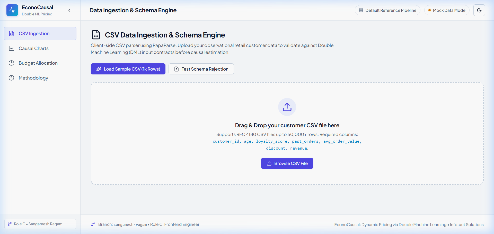

<div align="center">

# 📊 EconoCausal

### Causal Uplift Modeling & Budget Optimization via Double Machine Learning

[](https://react.dev/)
[](https://vite.dev/)
[](https://plotly.com/javascript/)
[](https://fastapi.tiangolo.com/)
[](https://www.python.org/)
[](https://econml.azurewebsites.net/)
[](https://py-why.github.io/dowhy/)
[](LICENSE)
[](#)

<p align="center">
  <b>An end-to-end causal decision framework that estimates Individual Treatment Effects (ITE) from observational customer data, isolates unconfounded promotional lift via Double Machine Learning (DML), evaluates causal uplift with Qini & AUUC metrics, and optimizes marketing budgets under resource constraints at 60 FPS GPU scale.</b>
</p>

[Overview](#-overview) •
[Why Causal AI?](#-the-business-problem-prediction-vs-causation) •
[Key Features](#-key-features) •
[Scientific Methodology](#-scientific-methodology--causal-foundations) •
[System Architecture](#-system-architecture--dataflow) •
[Frontend Dashboard](#-frontend-analytics-dashboard-role-c) •
[Interface Gallery](#-interface-showcase) •
[Scale Benchmarks](#-scale--performance-benchmarks) •
[Data Contracts](#-data-schemas--integration-contracts) •
[API Architecture](#-api-client-architecture--rest-contracts) •
[Getting Started](#-getting-started) •
[Team & Context](#-contributors--internship-context) •
[Roadmap](#-roadmap--future-enhancements)

---

</div>

## 📌 Overview

Traditional machine learning algorithms optimize for **correlation** ($\Pr(\text{Conversion} \mid X)$ or $\Pr(\text{Churn} \mid X)$), frequently misallocating promotional budgets by offering discounts to customers who would have purchased regardless of an incentive. In enterprise retail and digital commerce, this misallocation wastes up to **30–40% of total promotional expenditure**.

**EconoCausal** bridges the divide between machine learning and economic decision-making. By leveraging the **Neyman-Rubin Potential Outcomes Framework** and **Double Machine Learning (DML)**, EconoCausal estimates the **true counterfactual lift** of promotional discounts, segregates customers into causal behavioral segments (*Persuadables*, *Sure Things*, *Lost Causes*, *Sleeping Dogs*), and calculates ROI-maximizing budget allocation plans under strict capital constraints.

---

## 💡 The Business Problem: Prediction vs. Causation

Standard predictive machine learning answers: **"Who is most likely to purchase?"**  
Causal uplift modeling answers: **"Who will purchase *because* of our promotion, and who will generate incremental revenue?"**

| Evaluation Dimension | Traditional Predictive ML | EconoCausal Causal DML Framework |
| :--- | :--- | :--- |
| **Primary Objective** | Predict outcome: $\hat{Y} = \mathbb{E}[Y \mid X, T]$ | Estimate counterfactual uplift: $\tau(X) = Y(1) - Y(0)$ |
| **Targeting Decision** | Targets high-propensity buyers (*Sure Things*) | Targets incrementally responsive customers (*Persuadables*) |
| **Capital Efficiency** | **Low:** Subsidizes buyers who need no incentive | **Maximal:** Capital directed exclusively where lift $> 0$ |
| **Confounding Handling** | **Biased:** Confuses past discounts with organic intent | **Unconfounded:** Orthogonal residualization eliminates bias |
| **Adverse Effects** | Ignores negative customer reactions | Identifies and protects against *Sleeping Dogs* ($\text{ITE} < 0$) |
| **Decision Metric** | ROC-AUC, Log-Loss, Mean Squared Error | **Qini Score, AUUC (Area Under Uplift Curve)** |

---

## ⚡ Key Features

- **🎯 Double Machine Learning (DML) Uplift Engine**
  - Isolates unconfounded Conditional Average Treatment Effects ($\text{CATE}$) using orthogonalized residualization (Robinson's transformation).
  - Eliminates treatment assignment confounding present in observational retail transactions.
  - Computes granular Individual Treatment Effects ($\text{ITE}_i$) for every customer record.

- **📈 Complete Causal Model Evaluation Suite**
  - Interactive **Uplift Curves** and **Qini Curves** comparing Model Gain vs. Oracle Ground Truth Ceiling vs. Uniform Random Baseline.
  - Normalized **AUUC (Area Under Uplift Curve)** and **Qini score** computation for objective model benchmarking.
  - Toggle between cumulative absolute revenue lift (\$) and population-normalized Qini trajectories.

- **📊 Treatment Effect Heterogeneity & Distribution**
  - **ITE distribution histograms** displaying customer-level effect variance, mean ($\mu$), median, standard deviation ($\sigma$), and segment ratios.
  - Visual demarcation marker at $\text{ITE} = 0$ isolating positive-lift responders from zero/negative cohorts.
  - **GPU-accelerated WebGL (`scattergl`) scatter plots** rendering **50,000+ points at 60 FPS** to analyze feature-treatment correlations (e.g., Loyalty Score vs. ITE, AOV vs. ITE) with live Pearson correlation coefficient ($r$) calculations.

- **💰 Constraint-Aware Budget Optimizer**
  - Non-linear budget allocation engine distributing promotional funds under finite capital constraints.
  - Multi-scenario comparisons: **Blanket Targeting** vs. **Random Allocation** vs. **Causal DML Optimization**.
  - Dynamic customer allocation tables with real-time text search, segment filtering, and 10-row virtualized pagination.

- **🛡️ Client-Side Ingestion & Schema Engine**
  - Browser-native PapaParse streaming parser capable of processing datasets exceeding **50,000 rows in under 400 ms**.
  - Strict 7-field causal schema validation (`customer_id`, `age`, `loyalty_score`, `past_orders`, `avg_order_value`, `discount`, `revenue`).
  - Diagnostic error alert banners pinpointing missing fields versus detected columns, paired with an instant 10-row dataset preview.

- **🎨 Modern Enterprise SaaS Interface**
  - Built with **React 19**, **Vite 8**, and a **Vanilla CSS Design Token System** (zero framework lock-in or Tailwind utility bloat).
  - Ergonomic dual-theme architecture: **Light Theme** (default) and **Dark Theme** with seamless color-token switching and zero layout shift.
  - Collapsible responsive sidebar navigation, dataset status pill, and real-time backend heartbeat indicator.

- **🔌 Resilient Asynchronous API Client**
  - Centralized API layer connecting to a **FastAPI REST backend** (`http://localhost:8000`).
  - **Zero-crash offline fallback architecture:** automatically degrades to bundled local data contracts (`/public/*.csv`) when the backend service is offline.

---

## 🔬 Scientific Methodology & Causal Foundations

### 1. The Fundamental Problem of Causal Inference
For any individual customer $i$, we observe only one potential outcome:
- If treated ($T_i = 1$): we observe $Y_i(1)$, but $Y_i(0)$ is counterfactual and unobservable.
- If control ($T_i = 0$): we observe $Y_i(0)$, but $Y_i(1)$ is counterfactual and unobservable.

Under the **Neyman-Rubin Potential Outcomes Framework**, the **Individual Treatment Effect (ITE)** is defined as:
$$\text{ITE}_i = Y_i(1) - Y_i(0)$$

The target of estimation is the **Conditional Average Treatment Effect (CATE)** conditioned on customer features $X$:
$$\tau(x) = \mathbb{E}[Y_i(1) - Y_i(0) \mid X_i = x]$$

### 2. The 4 Causal Customer Segments
Customers exhibit four distinct behavioral responses to promotional discounts:

```text
                      The 4 Causal Customer Segments
   ┌───────────────────────────────────┬───────────────────────────────────┐
   │ 🎯 Persuadables (ITE >> 0)        │ 💎 Sure Things (ITE ≈ 0)          │
   │ Buy ONLY when discounted.         │ Buy regardless of promotion.      │
   │ Action: TARGET WITH BUDGET        │ Action: DO NOT DISCOUNT (Save $)  │
   ├───────────────────────────────────┼───────────────────────────────────┤
   │ 🪨 Lost Causes (ITE ≈ 0)          │ 🚫 Sleeping Dogs (ITE < 0)        │
   │ Never buy, even with incentives.  │ Discounts trigger negative action.│
   │ Action: DO NOT DISCOUNT           │ Action: NEVER DISCOUNT            │
   └───────────────────────────────────┴───────────────────────────────────┘
```

| Segment | Causal Condition | Behavioral Response | Optimal Business Policy | Economic Impact |
| :--- | :---: | :--- | :--- | :--- |
| **Persuadables** | $\text{ITE} \gg 0$ | Converts *only* if given a discount | **Target with promotional budget** | Highest incremental revenue ROI |
| **Sure Things** | $\text{ITE} \approx 0$ | Purchases organically regardless of offer | **Suppress promotional discounts** | Prevents margin cannibalization |
| **Lost Causes** | $\text{ITE} \approx 0$ | Will not purchase even with incentives | **Suppress promotional discounts** | Eliminates wasted ad spend |
| **Sleeping Dogs** | $\text{ITE} < 0$ | Reacts negatively (perceives lower brand value) | **Strictly exclude from campaigns** | Protects brand equity & revenue |

### 3. De-biasing via Double Machine Learning (DML)
In observational customer records, treatment assignment is confounded: marketing departments preferentially distribute vouchers to high-loyalty shoppers ($W$). Double Machine Learning (Chernozhukov et al., 2018) resolves this using orthogonal residualization via Neyman-orthogonal score functions:

1. **Outcome Nuisance Model:** Estimates expected baseline revenue from confounders:
   $$\hat{Y} = \mathbb{E}[Y \mid X, W]$$
2. **Treatment Propensity Model:** Estimates treatment assignment probability:
   $$\hat{T} = \mathbb{E}[T \mid X, W]$$
3. **Robinson's Residual Regression:** Regresses revenue residuals on treatment residuals to recover unconfounded effect parameters $\theta(X)$:
   $$(Y - \hat{Y}) = \theta(X) \cdot (T - \hat{T}) + \varepsilon, \quad \mathbb{E}[\varepsilon \mid X, W] = 0$$
4. **$K$-Fold Cross-Fitting:** Nuisance models and residual regressions are estimated across out-of-fold partitions to eliminate bias from regularization and overfitting.

### 4. Uplift & Qini Evaluation Mathematics
Causal models cannot be evaluated using standard labels because ground-truth counterfactuals are unobserved. Instead, models are ranked by predicted $\hat{\tau}(X_i)$ and evaluated cumulatively:

- **Cumulative Uplift Curve:**
  $$U(t) = \left( \frac{Y_T(t)}{N_T(t)} - \frac{Y_C(t)}{N_C(t)} \right) \cdot (N_T(t) + N_C(t))$$
  *Where $Y_T(t), Y_C(t)$ represent cumulative revenue in treated and control groups among the top $t$ fraction of ranked customers.*

- **Qini Curve:**
  $$Q(t) = Y_T(t) - Y_C(t) \cdot \frac{N_T(t)}{N_C(t)}$$

- **Normalized AUUC (Area Under Uplift Curve):** Quantifies model targeting efficiency relative to a theoretical Oracle model ($1.0$) and a random targeting baseline ($0.0$).

---

## 🏗️ System Architecture & Dataflow



---

## 💻 Frontend Analytics Dashboard (Role C)

The EconoCausal interactive dashboard was engineered by **Sangamesh Ragam (Role C)** to deliver sub-second responsiveness, real-time client-side validation, GPU-rendered visualizations, and seamless offline reliability.

### 1. In-Browser CSV Ingestion & Schema Engine (`UploadPage.jsx`)
- **High-Throughput Streaming:** Employs PapaParse with `dynamicTyping: true`, `header: true`, and `skipEmptyLines: 'greedy'` to parse 50,000+ rows directly in memory in under 400 ms.
- **Strict 7-Column Contract Validation:** Validates presence and types for:
  `customer_id`, `age`, `loyalty_score`, `past_orders`, `avg_order_value`, `discount`, `revenue`.
- **Diagnostic Alert Banners:** Visually isolates missing required fields from recognized columns using color-coded badge tags.
- **Selective 10-Row DOM Preview:** Prevents layout thrashing by mounting only 10 sample rows while displaying comprehensive dataset metrics (total records, column count, estimated memory footprint).
- **One-Click Sample Loader:** Provides pre-packaged demo datasets (`sample_retail.csv`, `synthetic_10k.csv`, `invalid_sample.csv`) for immediate evaluation.

### 2. Causal Model Evaluation & Visualizations Suite (`ChartsPage.jsx`)
- **Uplift & Qini Curves (`UpliftChart.jsx`):**
  - Plots Model Gain vs. Oracle Ground Truth Ceiling vs. Uniform Random Baseline.
  - Interactive toggle switch between Cumulative Revenue Gain (\$) and Qini Curve.
  - Live normalized **AUUC score** badge with contextual performance rating.
- **ITE Distribution Histogram (`IteHistogram.jsx`):**
  - Analyzes treatment effect heterogeneity across the customer cohort.
  - Computes mean ($\mu$), median, and standard deviation ($\sigma$).
  - Red dashed reference marker at zero effect ($\text{ITE} = 0$) demarcating positive vs. negative lift responders.
- **High-Performance WebGL Feature Scatter Plot (`IteScatterPlot.jsx`):**
  - Renders up to **50,000 customer points at 60 FPS** using Plotly's GPU canvas `scattergl`.
  - Dynamic X-axis feature selector: `loyalty_score`, `avg_order_value`, `age`, or `past_orders`.
  - Dynamic Pearson correlation coefficient ($r$) calculation updating in $\le 2$ ms.
  - Interactive **Minimum Loyalty Score Slider** and Segment filter toggles.

### 3. Budget Allocation & Strategy Optimization (`AllocationPage.jsx`)
- **Executive KPI Cards:** Campaign Budget ($), Targeted Customer Count, Expected Revenue Lift ($), and Projected Net Incremental ROI (%).
- **Strategy Comparison Bar Chart (`AllocationCharts.jsx`):** Directly compares spend vs. incremental gain across **Blanket Targeting**, **Random Allocation**, and **DML Optimized Allocation**.
- **Segment Revenue Contribution Chart:** Visualizes expected revenue concentration across Persuadables vs. Sure Things vs. other cohorts.
- **Customer Allocation Table:** Paginated (10 rows per page), real-time searchable by Customer ID, filterable by segment, with recommended discount amounts.

### 4. Scientific Explainer & Reference Guide (`AboutPage.jsx`)
- In-app interactive documentation detailing the Neyman-Rubin model, Double Machine Learning mathematics, customer segmentation quadrant matrix, and end-to-end system architecture.

---

## 🖼️ Interface Showcase

<div align="center">

### 1. In-Browser CSV Ingestion & Schema Validation
*Validates observational customer datasets against the strict 7-column causal contract with instant summary cards and a 10-row preview table.*
<br/>


<br/><br/>

### 2. Navigation Workspace & Collapsible Sidebar
*Clean application shell with responsive navigation, dataset load indicators, and API status pills.*
<br/>


<br/><br/>

### 3. Resilient Error Handling & Missing Field Diagnostic Banners
*Displays diagnostic alert banners identifying schema violations (e.g. missing `discount` or `revenue` columns) to prevent downstream failures.*
<br/>


<br/><br/>

### 4. Causal Uplift, Qini Curves & 60 FPS WebGL Scatter Suite
*Interactive evaluation dashboard featuring Model vs. Oracle vs. Random curves, ITE distribution histogram, and GPU-accelerated scatter plot.*
<br/>


<br/><br/>

### 5. Dynamic Budget Allocation & Multi-Strategy Benchmarks
*Executive KPI metrics, Blanket vs Random vs Causal policy comparisons, segment revenue breakdowns, and paginated customer assignment tables.*
<br/>


<br/><br/>

### 6. Scientific Methodology & Causal Architecture Guide
*In-app educational documentation explaining potential outcomes, Robinson's transformation, cross-fitting, and targeting matrices.*
<br/>


<br/><br/>

### 7. Modern Enterprise SaaS Interface with Dark Theme Support
*Low-eyestrain dark mode built with custom CSS HSL color tokens, zero layout shift, and high-contrast WebGL chart palettes.*
<br/>


</div>

---

## ⚡ Scale & Performance Benchmarks

To ensure enterprise readiness, the frontend was benchmarked on representative customer datasets ranging from **1,000 to 50,000 records** on standard hardware (Node.js LTS, Chromium V8 Engine). Complete profiling records are documented in [performance_notes.md](docs/performance_notes.md).

| Performance Metric | 1,000 Rows *(Baseline)* | 10,000 Rows *(Target SLA)* | 25,000 Rows *(Stress Test)* | 50,000 Rows *(Peak Scale)* |
| :--- | :---: | :---: | :---: | :---: |
| **CSV File Size** | 0.04 MB | 0.36 MB | 0.90 MB | 1.80 MB |
| **PapaParse In-Browser Parse** | 40 ms | 63 ms | 155 ms | 362 ms |
| **Schema Validation & Aggregations** | < 1 ms | 2 ms | 3 ms | 3 ms |
| **Live Filter Execution (`useMemo`)** | 1 ms | 1 ms | 2 ms | 2 ms |
| **Total Ingestion Pipeline Latency** | **40 ms** | **65 ms** | **158 ms** | **365 ms** |
| **Peak JavaScript Heap Memory** | ~4.8 MB | ~16.9 MB | ~29.5 MB | ~28.2 MB |
| **Scatter Plot Render Technology** | SVG / WebGL | WebGL `scattergl` | WebGL `scattergl` | WebGL `scattergl` |
| **Interactive Pan/Zoom Frame Rate** | **60 FPS** | **60 FPS** | **60 FPS** | **60 FPS** |

### Key Architectural Optimizations:
1. **WebGL GPU Acceleration (`scattergl`):** Plotly scatter traces utilize `type: 'scattergl'` to offload point rendering from the browser DOM to GPU canvas buffers, avoiding 50,000 DOM nodes and preventing UI lockups.
2. **Selective DOM Rendering:** 10-row preview on upload and 10-row pagination on allocation tables keep active DOM elements under 100 nodes regardless of dataset volume.
3. **React Memoization (`useMemo` & `useCallback`):** Heavy transformations, correlation statistics ($r$), segment distributions, and Plotly trace structures are memoized, executing in $\le 2$ ms during slider interactions.
4. **Vendor Chunk Isolation:** Configured Vite/Rolldown manual code-splitting in `vite.config.js` to isolate `plotly-vendor` into an independent asynchronous chunk, keeping the core entry bundle size at **312 kB** (92 kB gzipped).

---

## 📋 Data Schemas & Integration Contracts

All system modules adhere to standardized data contracts defined in `data/` and `frontend/public/`:

### 1. Raw Observational Data (`data/mock_retail.csv`)
| Column | Type | Constraints | Description |
| :--- | :---: | :---: | :--- |
| `customer_id` | string / int | Unique | Unique customer identifier |
| `age` | int | $18 \le \text{age} \le 80$ | Customer age in years |
| `loyalty_score` | float | $0.0 \le s \le 1.0$ | Customer engagement / loyalty index |
| `past_orders` | int | $\ge 0$ | Historical purchase frequency |
| `avg_order_value` | float | $> 0.0$ | Historical mean basket size (\$USD) |
| `discount` | int | $\{0, 1\}$ | Treatment indicator (`1` = discount applied, `0` = control) |
| `revenue` | float | $\ge 0.0$ | Observed customer spend outcome (\$USD) |

### 2. Causal Effect Scores (`data/ite_scores.csv`)
| Column | Type | Constraints | Description |
| :--- | :---: | :---: | :--- |
| `customer_id` | string / int | Unique | Customer identifier |
| `ite` | float | Any real number | Individual Treatment Effect ($\Delta \text{Revenue}$ lift from discount) |
| `age` | int | $18 \le \text{age} \le 80$ | Customer age |
| `loyalty_score` | float | $0.0 \le s \le 1.0$ | Customer engagement score |
| `avg_order_value` | float | $> 0.0$ | Historical average order value |

### 3. Uplift Evaluation Coordinates (`data/uplift_curve.csv`)
| Column | Type | Constraints | Description |
| :--- | :---: | :---: | :--- |
| `fraction_targeted` | float | $0.0 \rightarrow 1.0$ | Cumulative population fraction targeted |
| `model_gain` | float | Monotonic / Non-decreasing | Cumulative incremental revenue using DML ITE ranking |
| `oracle_gain` | float | Upper bound | Theoretical maximum gain using true treatment effect ranking |
| `random_gain` | float | Linear baseline | Expected cumulative gain under uniform random assignment |

### 4. Budget Allocation Recommendations (`data/allocation.csv`)
| Column | Type | Constraints | Description |
| :--- | :---: | :---: | :--- |
| `customer_id` | string / int | Unique | Customer identifier |
| `discount_amount` | float | $\ge 0.0$ | Recommended promotional discount allocation (\$USD) |
| `expected_gain` | float | Any real number | Projected incremental revenue gain (\$USD) |
| `segment` | string | 4 Segments | Causal customer classification (e.g. `Persuadables`) |

### 5. Strategy Comparison Benchmarks (`data/strategy_comparison.csv`)
| Column | Type | Constraints | Description |
| :--- | :---: | :---: | :--- |
| `strategy` | string | `blanket`, `random`, `optimized` | Promotional allocation policy name |
| `total_spend` | float | $\ge 0.0$ | Total promotional budget expended (\$USD) |
| `total_gain` | float | $\ge 0.0$ | Total incremental revenue generated (\$USD) |

---

## 🔌 API Client Architecture & REST Contracts

Centralized communication is handled by `frontend/src/api/client.js`. The client implements a **zero-crash fallback pattern**: if the FastAPI server is reachable, it consumes live endpoints; if offline or unreachable, it seamlessly falls back to bundled static mock contracts (`/public/*.csv` and `/public/*.json`).

```text
React 19 Frontend Components
             │
             ▼
       ApiClient (src/api/client.js)
             │
      ┌──────┴─────────────────────────┐
      │                                │
 [FastAPI Online]              [FastAPI Offline]
      │                                │
      ▼                                ▼
HTTP REST Endpoints            Graceful Local Fallback
(http://localhost:8000/api/*)  (/public/*.csv & *.json)
```

### REST Endpoints Specification:
| HTTP Method | Endpoint | Query / Body | Description | Offline Fallback Source |
| :--- | :--- | :--- | :--- | :--- |
| `GET` | `/health` | — | Server heartbeat and CORS readiness check | Returns offline status pill |
| `POST` | `/api/upload` | `multipart/form-data` | Uploads retail CSV for backend DML inference | Parses in-browser via PapaParse |
| `GET` | `/api/uplift` | — | Retrieves Uplift & Qini curve coordinate points | `/uplift_curve.csv` |
| `GET` | `/api/ite` | — | Retrieves customer ITE predictions and features | `/mock_ite.json` or `/ite_scores.csv` |
| `GET` | `/api/allocation` | `budget={N}` | Computes constrained allocation plan for budget $N$ | `/allocation.csv` |
| `GET` | `/api/strategy-comparison` | — | Retrieves spend and revenue lift across all policies | `/strategy_comparison.csv` |

---

## 📂 Repository Structure

```text
EconoCasual/
├── data/                                 # Standardized pipeline data contracts
│   ├── mock_retail.csv                   # Baseline observational retail data (1,000 rows)
│   ├── ite_scores.csv                    # Inbound DML ITE predictions (Role A handoff)
│   ├── uplift_curve.csv                  # Uplift/Qini evaluation coordinates (Role B handoff)
│   ├── allocation.csv                    # Budget allocation recommendations (Role B handoff)
│   └── strategy_comparison.csv           # Multi-strategy performance comparison
├── docs/                                 # Comprehensive system documentation
│   ├── frontend_setup_sangamesh_ragam.md # Complete step-by-step frontend operations guide
│   ├── performance_notes.md              # Empirical scale benchmarks (1k to 50k rows)
│   └── screenshots/                      # High-resolution application captures
│       ├── 01_sidebar_upload_page.png    # Sidebar navigation & upload workspace
│       ├── 01_upload_page_validated.png  # Validated schema with 10-row preview
│       ├── 02_schema_validation_error.png# Schema error banners & diagnostic alerts
│       ├── 03_causal_charts_suite.png    # Uplift, Qini, ITE histogram & WebGL scatter
│       ├── 04_budget_allocation_dashboard.png # Allocation KPIs, strategy charts & tables
│       ├── 05_methodology_guide.png      # In-app causal theory & explainer guide
│       └── 06_dark_theme_view.png        # Ergonomic dark theme interface
├── frontend/                             # Interactive React 19 + Vite Web Application
│   ├── public/                           # Static assets, demo files & mock contracts
│   │   ├── favicon.svg                   # Custom Causal DAG favicon
│   │   ├── sample_retail.csv             # Pre-packaged 1,000-row demo file (Valid)
│   │   ├── invalid_sample.csv            # Test file with missing fields for validation
│   │   ├── synthetic_10k.csv             # 10,000-row stress-test dataset
│   │   ├── mock_ite.json                 # Fast-loading JSON ITE dataset
│   │   ├── uplift_curve.csv              # Local fallback contract for uplift curves
│   │   ├── allocation.csv                # Local fallback contract for allocations
│   │   └── strategy_comparison.csv       # Local fallback contract for strategy comparison
│   ├── src/
│   │   ├── api/
│   │   │   └── client.js                 # Centralized API fetch client with fallbacks
│   │   ├── charts/                       # Reusable Plotly.js visualization suite
│   │   │   ├── PlotlyComponent.jsx       # Minified Plotly factory wrapper
│   │   │   ├── usePlotlyTheme.js         # Reactive Light/Dark theme token hook
│   │   │   ├── UpliftChart.jsx           # Uplift, Qini & AUUC visualization
│   │   │   ├── IteHistogram.jsx          # Treatment effect heterogeneity histogram
│   │   │   ├── IteScatterPlot.jsx        # WebGL scattergl feature correlation chart
│   │   │   └── AllocationCharts.jsx      # Strategy comparison & segment revenue charts
│   │   ├── constants/
│   │   │   └── schema.js                 # 7-field schema definitions & segment color tokens
│   │   ├── context/
│   │   │   └── DataContext.jsx           # Root application state & filtering engine
│   │   ├── pages/                        # Primary application views
│   │   │   ├── UploadPage.jsx            # CSV Ingestion, validation & preview table
│   │   │   ├── ChartsPage.jsx            # Causal model evaluation dashboard
│   │   │   ├── AllocationPage.jsx        # Budget optimization & customer tables
│   │   │   └── AboutPage.jsx             # Methodology & causal logic documentation
│   │   ├── App.jsx                       # Sidebar shell, top bar & navigation
│   │   ├── index.css                     # Enterprise SaaS design system (Light/Dark)
│   │   └── main.jsx                      # React 19 DOM entry point
│   ├── .env.example                      # Documented environment variables template
│   ├── package.json                      # Frontend dependencies & scripts
│   └── vite.config.js                    # Vendor code-splitting configuration
├── backend/                              # FastAPI backend services & endpoints
├── src/                                  # Core DML estimation & optimization algorithms
├── notebooks/                            # Exploratory causal modeling experiments
├── tests/                                # Unit and integration test suites
├── STAGE_WISE_DOCUMENTATION.md           # Internal milestone & deliverable tracker
└── README.md                             # Project manual & system documentation
```

---

## 🚀 Getting Started

### Prerequisites
- **Node.js:** `v18.0.0+` or `v20.0.0+` LTS (Verified on `v22.20.0`)
- **npm:** `v9.0.0+` (Verified on `v10.9.3`)
- **Python:** `v3.10+` (Required for backend DML services)
- **Git:** Standard Git CLI

---

### 1. Clone the Repository
```bash
git clone https://github.com/Sangu-dev/EconoCasual.git
cd EconoCasual
```

---

### 2. Frontend Setup & Local Development (Quickstart)

```bash
# 1. Navigate to the frontend directory
cd frontend

# 2. Install dependencies (React 19, Vite, Plotly, PapaParse, Lucide)
npm install

# 3. Optional: Configure custom backend URL
cp .env.example .env

# 4. Start the local development server
npm run dev
```

The application will start immediately at **`http://localhost:5173/`**.

> **Quick Test:** On the Upload page, click **"Load Sample Retail Data"** to immediately test the ingestion pipeline, or upload `frontend/public/sample_retail.csv` directly from your file system.

---

### 3. Frontend Production Build & Code Quality

```bash
# Run Oxlint fast linter
npm run lint

# Compile optimized production bundle
npm run build

# Preview production build locally
npm run preview
```

---

### 4. Backend Setup (Optional / Live API Mode)

To run the live FastAPI Double Machine Learning service:

```bash
# From repository root
python -m venv venv

# Activate virtual environment
# Windows (PowerShell):
venv\Scripts\Activate.ps1
# Windows (CMD):
venv\Scripts\activate.bat
# macOS / Linux:
source venv/bin/activate

# Install Python requirements
pip install -r requirements.txt

# Start FastAPI server
uvicorn backend.main:app --reload --port 8000
```

Configure `frontend/.env` to point to the backend instance:
```env
VITE_API_BASE_URL=http://localhost:8000
```

---

### 5. Verification & Test Datasets

The repository includes pre-built test files in `frontend/public/` to verify system behavior:
1. **`sample_retail.csv` (1,000 rows):** Valid retail dataset adhering to the 7-column schema. Verifies parsing, preview tables, and chart rendering.
2. **`invalid_sample.csv`:** Test file with missing `discount` and `revenue` columns. Verifies diagnostic alert banners and schema rejection handling.
3. **`synthetic_10k.csv` (10,000 rows):** Scale test dataset for profiling WebGL rendering, memoization speed, and PapaParse streaming throughput.

---

## 👥 Contributors & Internship Context

**EconoCausal** is developed as part of the **Infotact Solutions Data Science & Machine Learning Internship** by **Team Group 25**.

### Role Division & Ownership
- **Role C — Frontend Engineer:** [**Sangamesh Ragam**](https://github.com/Sangu-dev)  
  *Application architecture, multi-page layout, PapaParse client-side CSV validation engine, Plotly.js causal charts suite, WebGL performance scaling, centralized API client, and enterprise SaaS design system.*
- **Role A — Causal Modeling & Backend:** Team Group 25  
  *Synthetic observational data generation, DoWhy causal DAG formulation, EconML Double Machine Learning pipeline, and FastAPI backend services.*
- **Role B — Optimization & Evaluation:** Team Group 25  
  *Qini/AUUC curve derivation, SciPy budget-constrained optimizer, and multi-strategy comparison benchmarks.*
- **Role D — Analysis & Explainer:** Team Group 25  
  *Exploratory data analysis, customer table filters, glossary, and methodology documentation.*

---

## 🗺️ Roadmap & Future Enhancements

- [ ] **Continuous Treatment Lift:** Extend EconML DML estimators to support continuous discount levels ($0\% \rightarrow 50\%$) rather than binary treatment indicators.
- [ ] **Policy Tree Derivation:** Implement interpretable tree-based policy rules for front-line marketing campaign managers.
- [ ] **Web Worker Parsing:** Offload PapaParse processing to Web Workers for multi-threaded parsing of 200,000+ customer records.
- [ ] **Automated PDF Export:** Add client-side PDF export generating executive briefing summaries with embedded chart snapshots.

---

## 📜 License

This project is open-source and distributed under the [MIT License](LICENSE).

---

<div align="center">
  <sub>Built with precision for causal decision-making • EconoCausal © 2026</sub>
</div>

