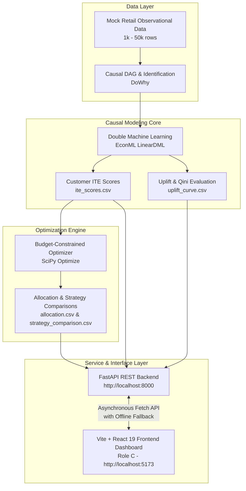
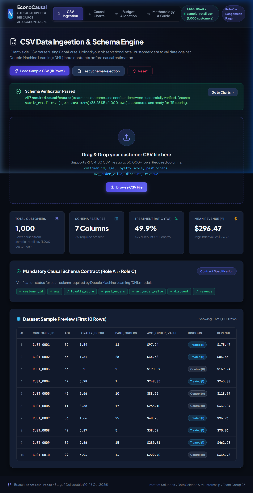
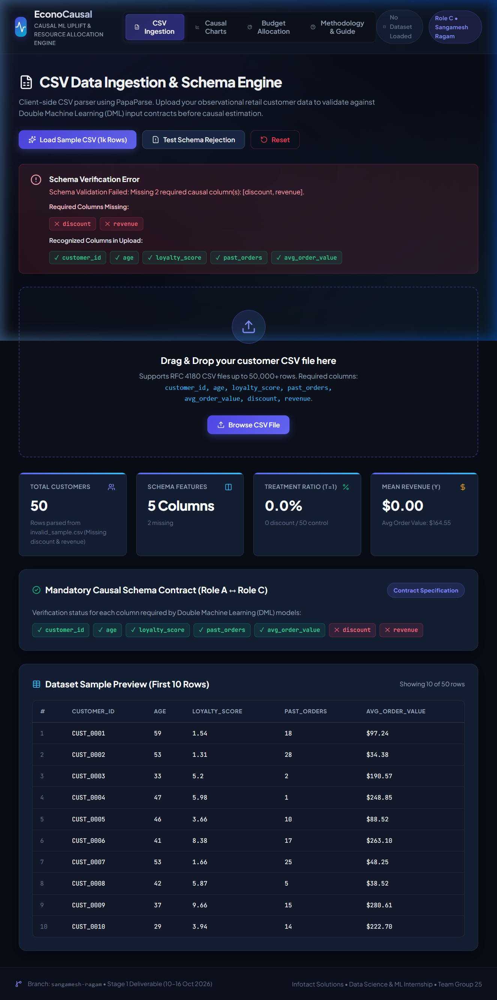
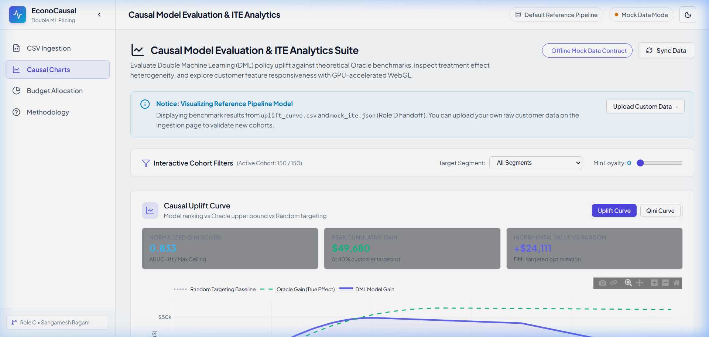
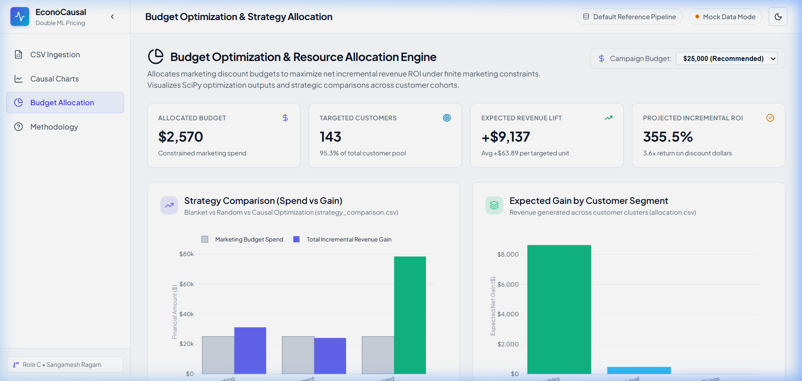
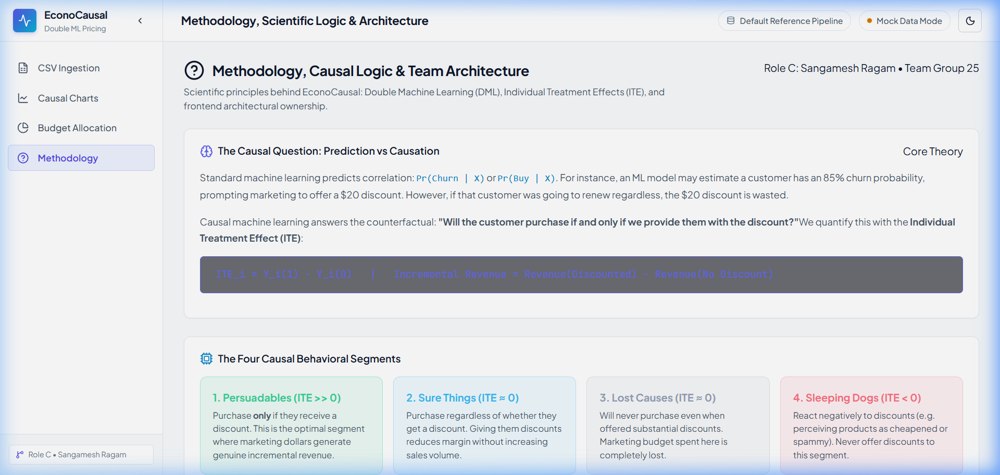
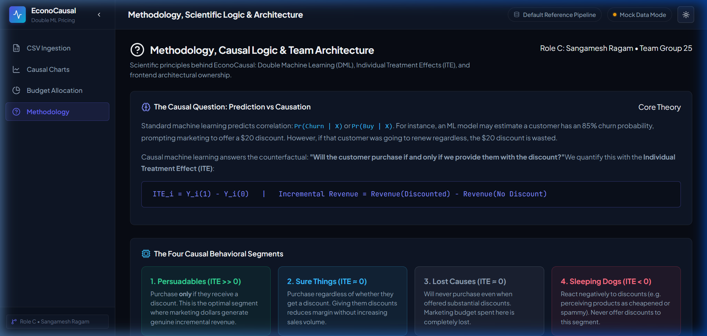

<div align="center">

# 📊 EconoCausal

### Causal Uplift Modeling & Budget Optimization via Double Machine Learning

[](https://react.dev/)
[](https://vite.dev/)
[](https://plotly.com/javascript/)
[](https://fastapi.tiangolo.com/)
[](https://www.python.org/)
[](LICENSE)
[](#)

<p align="center">
  <b>A state-of-the-art causal decision framework that estimates Individual Treatment Effects (ITE) from observational customer data, evaluates uplift via Qini and AUUC metrics, and optimizes marketing spend under resource constraints using Double Machine Learning (DML).</b>
</p>

[Key Features](#-key-features) •
[Scientific Methodology](#-scientific-methodology--causal-logic) •
[System Architecture](#-system-architecture) •
[Frontend Dashboard](#-frontend-analytics-dashboard-role-c) •
[Interface Gallery](#-interface-showcase) •
[Scale Benchmarks](#-scale--performance-benchmarks) •
[Data Contracts](#-data-schemas--integration-contracts) •
[Getting Started](#-getting-started) •
[Contributors](#-contributors--internship-context)

---

</div>

## 📌 Overview

Traditional machine learning algorithms optimize for **correlation** ($\Pr(\text{Conversion} \mid X)$ or $\Pr(\text{Churn} \mid X)$), frequently misallocating marketing budgets by targeting customers who would have purchased regardless of an incentive. 

**EconoCausal** bridges the gap between machine learning and economic decision-making. By leveraging the **Neyman-Rubin Potential Outcomes Framework** and **Double Machine Learning (DML)**, EconoCausal estimates the **true counterfactual lift** of promotional discounts, segregates customers into causal behavioral segments (*Persuadables*, *Sure Things*, *Lost Causes*, *Sleeping Dogs*), and calculates ROI-maximizing budget allocation plans.

---

## ⚡ Key Features

- **🎯 Double Machine Learning (DML) Uplift Estimation**
  - Isolates unconfounded Conditional Average Treatment Effects ($\text{CATE}$) using orthogonalized residualization (Robinson's transformation).
  - Eliminates treatment assignment bias found in observational retail records.

- **📈 Complete Causal Model Evaluation Suite**
  - Interactive **Uplift Curves** and **Qini Curves** comparing Model Gain vs. Oracle Ground Truth vs. Uniform Random Targeting.
  - Normalized **AUUC (Area Under Uplift Curve)** and **Qini score** computation for objective model comparison.

- **📊 Treatment Effect Heterogeneity & Distribution**
  - **ITE distribution histograms** displaying customer-level effect variance, zero-effect demarcation, and segment proportions.
  - **GPU-accelerated WebGL (`scattergl`) scatter plots** rendering 50,000+ points at 60 FPS to analyze feature-treatment correlations (e.g., Loyalty Score vs. ITE) with live Pearson $r$ calculations.

- **💰 Constraint-Aware Budget Optimizer**
  - SciPy-driven non-linear budget optimization distributing capital to maximize incremental revenue.
  - Multi-scenario comparisons: **Blanket Targeting** vs. **Random Allocation** vs. **Causal DML Optimization**.
  - Customer-level allocation tables with search, segment filtering, and 10-row pagination.

- **🚀 Client-Side Ingestion & Schema Engine**
  - Browser-native PapaParse streaming engine supporting datasets exceeding 50,000 rows.
  - Strict 7-field causal schema validation (`customer_id`, `age`, `loyalty_score`, `past_orders`, `avg_order_value`, `discount`, `revenue`) with real-time error banners and 10-row preview rendering.

- **🎨 Modern Enterprise SaaS Interface**
  - Built with **React 19**, **Vite**, and **Vanilla CSS tokens** (no Tailwind bloat).
  - Dual theme architecture: **Light Theme** (default) and **Dark Theme** with smooth transitions and collapsible navigation.

---

## 🔬 Scientific Methodology & Causal Logic

### 1. The Core Dilemma: Prediction vs. Causation
Standard machine learning predicts correlation:
$$\Pr(\text{Buy} \mid X, \text{Discount})$$
If a high-loyalty customer has an 85% probability of buying, sending them a \$20 discount voucher yields zero incremental revenue—wasting company capital.

Causal inference asks the counterfactual question:
> *"Will the customer buy **if and only if** we offer the discount?"*

### 2. Neyman-Rubin Causal Framework & ITE
For each customer $i$, we estimate the **Individual Treatment Effect (ITE)**:
$$\text{ITE}_i = Y_i(1) - Y_i(0)$$

Where:
- $Y_i(1)$: Observed revenue if given a discount (Treated).
- $Y_i(0)$: Observed revenue if no discount is given (Control).

```
                      The 4 Causal Customer Segments
   ┌───────────────────────────────────┬───────────────────────────────────┐
   │ 🎯 Persuadables (ITE >> 0)        │ 💎 Sure Things (ITE ≈ 0)          │
   │ Buy ONLY when discounted.         │ Buy regardless of promotion.      │
   │ Action: TARGET WITH BUDGET        │ Action: DO NOT DISCOUNT (Save $)  │
   ├───────────────────────────────────┼───────────────────────────────────┤
   │ 🪨 Lost Causes (ITE ≈ 0)          │ 🚫 Sleeping Dogs (ITE < 0)        │
   │ Never buy, even with incentives.  │ Discounts trigger negative action.│
   │ Action: DO NOT DISCOUNT           │ Action: NEVER DISCOUNT            │
   └───────────────────────────────────┴───────────────────────────────────┘
```

### 3. De-biasing via Double Machine Learning (DML)
In observational retail data, promotional discounts are rarely assigned at random; marketing teams disproportionately target active or high-loyalty shoppers (**confounders** $W$).

Double Machine Learning breaks this confounding via two cross-fitted auxiliary predictive models:
1. **Outcome Model:** $\hat{Y} = \mathbb{E}[Y \mid X, W]$ (Predicts baseline revenue).
2. **Propensity Model:** $\hat{T} = \mathbb{E}[T \mid X, W]$ (Predicts discount likelihood).
3. **Orthogonal Residual Regression:** Regresses revenue residuals $(Y - \hat{Y})$ on treatment residuals $(T - \hat{T})$ to extract unconfounded causal effect parameters:
$$(Y - \hat{Y}) = \theta(X) \cdot (T - \hat{T}) + \varepsilon$$

---

## 🏗️ System Architecture



---

## 💻 Frontend Analytics Dashboard (Role C)

The EconoCausal web application is an interactive analytical suite developed by **Sangamesh Ragam (Role C)**, engineered for sub-second responsiveness, real-time client-side validation, and GPU-rendered visualizations.

### 1. In-Browser CSV Ingestion & Schema Engine (`UploadPage.jsx`)
- **PapaParse client-side stream parser:** parses 50,000+ rows directly in memory in under 400 ms.
- **Strict 7-column schema verification:** checks presence, data types, and nullity for `customer_id`, `age`, `loyalty_score`, `past_orders`, `avg_order_value`, `discount`, `revenue`.
- **Informative error banners:** pinpoints missing columns vs. recognized columns with diagnostic badges.
- **Selective 10-row preview:** prevents layout thrashing while providing full dataset summary statistics (row count, column count, estimated memory footprint).

### 2. Causal Evaluation & Visualizations Suite (`ChartsPage.jsx`)
- **Uplift & Qini Curves (`UpliftChart.jsx`):**
  - Displays Model Gain vs. Oracle Ground Truth Ceiling vs. Random Baseline.
  - Interactive toggle between standard Cumulative Uplift (\$) and Qini Curve.
  - Live normalized **AUUC** score metric display.
- **ITE Distribution Histogram (`IteHistogram.jsx`):**
  - Evaluates treatment effect heterogeneity with mean ($\mu$), median, and standard deviation ($\sigma$).
  - Red dashed zero-effect reference marker separating net-positive responders from negative/neutral segments.
- **High-Performance WebGL Feature Scatter Plot (`IteScatterPlot.jsx`):**
  - Renders up to 50,000 customer points at silky-smooth 60 FPS using Plotly's GPU canvas `scattergl`.
  - Feature selector: ITE vs. Loyalty Score, Average Order Value, Age, or Past Orders.
  - Dynamic Pearson correlation coefficient ($r$) calculation.
  - Segment filtering and **Minimum Loyalty Slider** with sub-2ms recalculation times.

### 3. Budget Allocation & Strategy Engine (`AllocationPage.jsx`)
- **Executive KPI Cards:** Campaign Budget, Targeted Customer Volume, Expected Revenue Lift, Projected Net ROI.
- **Strategy Comparison Bar Chart (`AllocationCharts.jsx`):** Evaluates total marketing spend and incremental gain across **Blanket**, **Random**, and **DML Optimized** policies.
- **Segment Revenue Contribution:** Bar chart illustrating revenue concentration across Persuadables vs. other customer cohorts.
- **Paginated Customer Allocation Table:** Searchable by Customer ID, filterable by segment, with 10-row pagination and discount recommendations.

### 4. Methodology & Explainer Guide (`AboutPage.jsx`)
- Interactive educational reference covering the Neyman-Rubin model, Double ML mathematics, segment targeting matrices, and system architecture.

---

## 🖼️ Interface Showcase

<div align="center">

### 1. In-Browser CSV Upload & Schema Validation
*Validates retail datasets against the 7-column causal schema with instant summary metrics and 10-row preview.*
<br/>


<br/><br/>

### 2. Resilient Error Handling & Missing Column Alerts
*Displays diagnostic alert banners identifying missing schema fields (e.g. missing `discount` or `revenue`).*
<br/>


<br/><br/>

### 3. Causal Uplift, Qini Curves & WebGL Scatter Suite
*Plotly-powered interactive evaluation suite featuring Model vs. Oracle vs. Random curves and GPU-accelerated scatter plots.*
<br/>


<br/><br/>

### 4. Dynamic Budget Allocation & Strategy Optimization
*Strategy comparison across Blanket, Random, and Causal Optimization with paginated customer assignment tables.*
<br/>


<br/><br/>

### 5. Scientific Methodology & System Architecture Guide
*In-app educational documentation explaining Double ML mathematics, counterfactuals, and segment taxonomy.*
<br/>


<br/><br/>

### 6. Modern SaaS Design with Dark Theme Support
*Ergonomic, low-eyestrain dark mode engineered with custom CSS HSL color tokens and zero styling flickers.*
<br/>


</div>

---

## ⚡ Scale & Performance Benchmarks

To ensure enterprise readiness, the frontend was benchmarked on representative customer datasets up to **50,000 records** on standard hardware (Node.js LTS, Chromium V8 Engine). Full documentation is available in [performance_notes.md](docs/performance_notes.md).

| Performance Metric | 1,000 Rows *(Baseline)* | 10,000 Rows *(Target SLA)* | 25,000 Rows *(Stress)* | 50,000 Rows *(Peak Scale)* |
| :--- | :---: | :---: | :---: | :---: |
| **CSV File Size** | 0.04 MB | 0.36 MB | 0.90 MB | 1.80 MB |
| **PapaParse In-Browser Parse** | 40 ms | 63 ms | 155 ms | 362 ms |
| **Schema Validation & Aggregations** | < 1 ms | 2 ms | 3 ms | 3 ms |
| **Live Filter Execution (`useMemo`)** | 1 ms | 1 ms | 2 ms | 2 ms |
| **Total Ingestion Pipeline Latency** | **40 ms** | **65 ms** | **158 ms** | **365 ms** |
| **Peak JavaScript Heap Memory** | ~4.8 MB | ~16.9 MB | ~29.5 MB | ~28.2 MB |
| **Scatter Plot Render Technology** | SVG / WebGL | WebGL `scattergl` | WebGL `scattergl` | WebGL `scattergl` |
| **Interactive Pan/Zoom Frame Rate** | **60 FPS** | **60 FPS** | **60 FPS** | **60 FPS** |

### Key Architectural Optimizations:
1. **WebGL GPU Acceleration:** Plotly traces use `type: 'scattergl'` to offload rendering from DOM nodes to the GPU canvas buffer, eliminating DOM thrashing.
2. **Selective DOM Rendering:** 10-row preview and pagination limit active table nodes to under 100 elements regardless of dataset volume.
3. **React Memoization:** Critical transformations, correlations ($r$), and segment splits are wrapped in `useMemo` hooks to execute in $\le 2$ ms.
4. **Vendor Chunk Isolation:** Configured Vite/Rolldown manual code-splitting to isolate Plotly vendor libraries, keeping core entry bundle size at **312 kB**.

---

## 📋 Data Schemas & Integration Contracts

All system modules adhere to standardized data contracts defined in `data/` and `frontend/public/`:

### 1. Raw Observational Data (`data/mock_retail.csv`)
| Column | Type | Description |
| :--- | :---: | :--- |
| `customer_id` | string / int | Unique customer identifier |
| `age` | int | Customer age in years |
| `loyalty_score` | float | Customer engagement index ($0.0 \rightarrow 1.0$) |
| `past_orders` | int | Historical purchase frequency |
| `avg_order_value` | float | Historical mean basket size (\$USD) |
| `discount` | int | Treatment indicator (`1` = discount applied, `0` = control) |
| `revenue` | float | Observed customer spend outcome (\$USD) |

### 2. Causal Prediction Output (`data/ite_scores.csv`)
| Column | Type | Description |
| :--- | :---: | :--- |
| `customer_id` | string / int | Customer identifier |
| `ite` | float | Individual Treatment Effect ($\Delta \text{Revenue}$ lift from discount) |
| `age` | int | Customer age |
| `loyalty_score` | float | Loyalty score |
| `avg_order_value` | float | Average order value |

### 3. Uplift Evaluation (`data/uplift_curve.csv`)
| Column | Type | Description |
| :--- | :---: | :--- |
| `fraction_targeted` | float | Cumulative proportion of population targeted ($0.0 \rightarrow 1.0$) |
| `model_gain` | float | Cumulative incremental revenue using DML ITE ranking |
| `oracle_gain` | float | Theoretical maximum gain using true treatment effect ranking |
| `random_gain` | float | Baseline cumulative gain under uniform random assignment |

### 4. Allocation Recommendation (`data/allocation.csv`)
| Column | Type | Description |
| :--- | :---: | :--- |
| `customer_id` | string / int | Customer identifier |
| `discount_amount` | float | Recommended discount allocation (\$USD) |
| `expected_gain` | float | Expected incremental revenue gain (\$USD) |
| `segment` | string | Causal customer classification (e.g. `Persuadables`) |

### 5. Strategy Comparison (`data/strategy_comparison.csv`)
| Column | Type | Description |
| :--- | :---: | :--- |
| `strategy` | string | Strategy name: `blanket`, `random`, or `optimized` |
| `total_spend` | float | Total promotional budget expended (\$USD) |
| `total_gain` | float | Total incremental revenue generated (\$USD) |

---

## 🔌 API Client Architecture (`client.js`)

The frontend integrates with the backend via a centralized, asynchronous client module located at `frontend/src/api/client.js`. It features **zero-crash fallback mechanisms** that seamlessly switch to local mock contracts if the FastAPI backend is offline.

```text
Frontend React UI
       │
       ▼
  ApiClient (src/api/client.js)
       │
       ├─► [Online]  ──► Fetch FastAPI (http://localhost:8000/api/*)
       │
       └─► [Offline] ──► Graceful Fallback to Local CSV Contracts (/public/*)
```

| HTTP Method | Endpoint | Description | Fallback Contract |
| :--- | :--- | :--- | :--- |
| `GET` | `/health` | Server heartbeat and CORS readiness check | Status indicator pill in UI |
| `POST` | `/api/upload` | Multi-part upload of retail CSV for inference | In-browser PapaParse engine |
| `GET` | `/api/uplift` | Fetches Uplift and Qini coordinate arrays | `/uplift_curve.csv` |
| `GET` | `/api/ite` | Fetches customer ITE scores and feature sets | `/mock_ite.json` or `/ite_scores.csv` |
| `GET` | `/api/allocation?budget={N}` | Computes optimal allocation for budget $N$ | `/allocation.csv` |
| `GET` | `/api/strategy-comparison` | Returns spend vs. gain across all policies | `/strategy_comparison.csv` |

---

## 📂 Repository Structure

```text
EconoCasual/
├── data/                                 # Standardized pipeline data contracts
│   ├── mock_retail.csv                   # Baseline observational retail data (1,000 rows)
│   ├── ite_scores.csv                    # Inbound DML ITE predictions (Role A handoff)
│   ├── uplift_curve.csv                  # Uplift/Qini evaluation coordinates (Role B handoff)
│   ├── allocation.csv                    # Budget allocation recommendations (Role B handoff)
│   └── strategy_comparison.csv           # Multi-strategy performance comparison
├── docs/                                 # System documentation & benchmarks
│   ├── frontend_setup_sangamesh_ragam.md # Complete step-by-step frontend guide
│   ├── performance_notes.md              # Empirical scale benchmarks (1k to 50k rows)
│   └── screenshots/                      # High-resolution application screenshots
├── frontend/                             # Interactive React 19 + Vite Web Application
│   ├── public/                           # Static assets, logos, and mock fallback files
│   │   ├── favicon.svg                   # Custom Causal Graph SVG favicon
│   │   ├── sample_retail.csv             # Pre-packaged 1,000-row demo file
│   │   ├── invalid_sample.csv            # Test file for schema error verification
│   │   └── synthetic_10k.csv             # 10,000-row stress-test dataset
│   ├── src/
│   │   ├── api/
│   │   │   └── client.js                 # Asynchronous API fetch client with fallbacks
│   │   ├── charts/                       # Reusable Plotly.js visualization suite
│   │   │   ├── PlotlyComponent.jsx       # Minified Plotly factory wrapper
│   │   │   ├── usePlotlyTheme.js         # Reactive Light/Dark theme token hook
│   │   │   ├── UpliftChart.jsx           # Uplift, Qini & AUUC visualization
│   │   │   ├── IteHistogram.jsx          # Treatment effect heterogeneity histogram
│   │   │   ├── IteScatterPlot.jsx        # WebGL scattergl feature correlation chart
│   │   │   └── AllocationCharts.jsx      # Strategy comparison & segment revenue charts
│   │   ├── constants/
│   │   │   └── schema.js                 # Schema definitions & segment color tokens
│   │   ├── context/
│   │   │   └── DataContext.jsx           # Root application state & filtering engine
│   │   ├── pages/                        # Primary application views
│   │   │   ├── UploadPage.jsx            # CSV Ingestion, validation & table preview
│   │   │   ├── ChartsPage.jsx            # Causal model evaluation dashboard
│   │   │   ├── AllocationPage.jsx        # Budget optimization & customer tables
│   │   │   └── AboutPage.jsx             # Methodology & causal logic documentation
│   │   ├── App.jsx                       # Sidebar, header layout & navigation
│   │   ├── index.css                     # Enterprise SaaS design system (Light/Dark)
│   │   └── main.jsx
│   ├── package.json                      # Frontend dependencies & scripts
│   └── vite.config.js                    # Vendor code-splitting configuration
├── backend/                              # FastAPI service endpoints
├── src/                                  # Core DML estimation & optimization logic
├── notebooks/                            # Exploratory causal modeling experiments
├── tests/                                # Unit and integration test suites
├── STAGE_WISE_DOCUMENTATION.md           # Internal milestone and deliverable tracker
└── README.md                             # Project overview and system manual
```

---

## 🚀 Getting Started

### Prerequisites
- **Node.js:** v18.0+ or v20.0+ LTS (Tested on `v22.20.0`)
- **Python:** v3.10+ (For backend DML services)
- **Git:** Standard Git CLI

### 1. Clone the Repository
```bash
git clone https://github.com/Sangu-dev/EconoCasual.git
cd EconoCasual
```

### 2. Frontend Dashboard Setup (Quickstart)
```bash
# Navigate to the frontend directory
cd frontend

# Install dependencies (React 19, Vite, Plotly, PapaParse, Lucide)
npm install

# Start the local development server
npm run dev
```

Open your browser and navigate to **`http://localhost:5173/`**.

> **Tip:** You can immediately test the dashboard by clicking **"Load Sample Retail Data"** on the upload page, or upload `frontend/public/sample_retail.csv` directly.

### 3. Frontend Production Build & Verification
```bash
# Compile optimized production bundle
npm run build

# Preview the production build locally
npm run preview
```

### 4. Backend Setup (Optional / Live API Mode)
```bash
# From repository root
python -m venv venv

# Activate virtual environment
# Windows:
venv\Scripts\activate
# macOS / Linux:
source venv/bin/activate

# Install Python requirements
pip install -r requirements.txt

# Start FastAPI server
uvicorn backend.main:app --reload --port 8000
```

Configure the frontend API URL (if non-default) by creating `frontend/.env`:
```env
VITE_API_BASE_URL=http://localhost:8000
```

---

## 👥 Contributors & Internship Context

**EconoCausal** is developed as part of the **Infotact Solutions Data Science & Machine Learning Internship** by **Team Group 25**.

### Role Division & Ownership
- **Role C — Frontend Engineer:** [**Sangamesh Ragam**](https://github.com/Sangu-dev)  
  *Application shell, multi-page layout, client-side CSV validation engine, Plotly.js causal charts suite, WebGL performance scaling, centralized API client, and enterprise SaaS design system.*
- **Role A — Causal Modeling & Backend:** Team Group 25  
  *Synthetic observational data generation, DoWhy causal graph formulation, EconML Double Machine Learning pipeline, and FastAPI backend services.*
- **Role B — Optimization & Evaluation:** Team Group 25  
  *Qini/AUUC curve derivation, SciPy budget-constrained optimizer, and strategy comparison benchmarks.*
- **Role D — Analysis & Explainer:** Team Group 25  
  *Exploratory data analysis, customer table filters, and glossary documentation.*

---

## 📜 License

This project is open-source and distributed under the [MIT License](LICENSE).

---

<div align="center">
  <sub>Built with precision for causal decision-making • EconoCausal © 2026</sub>
</div>
