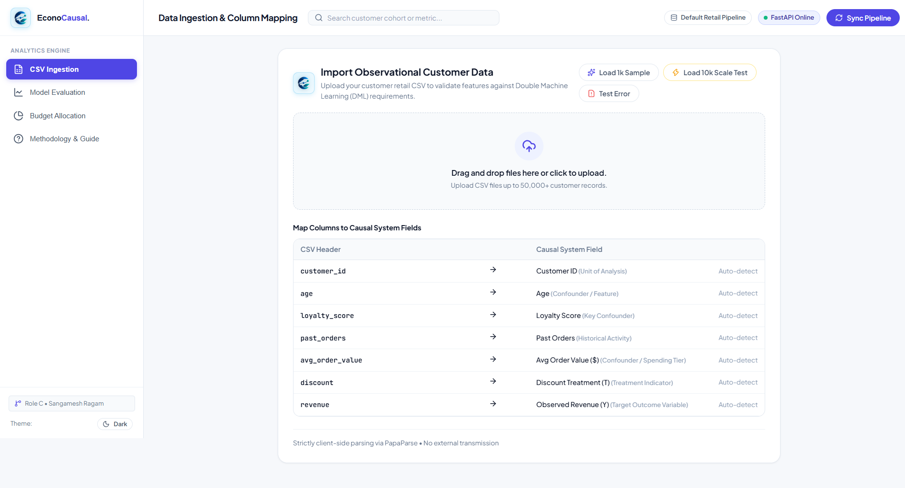
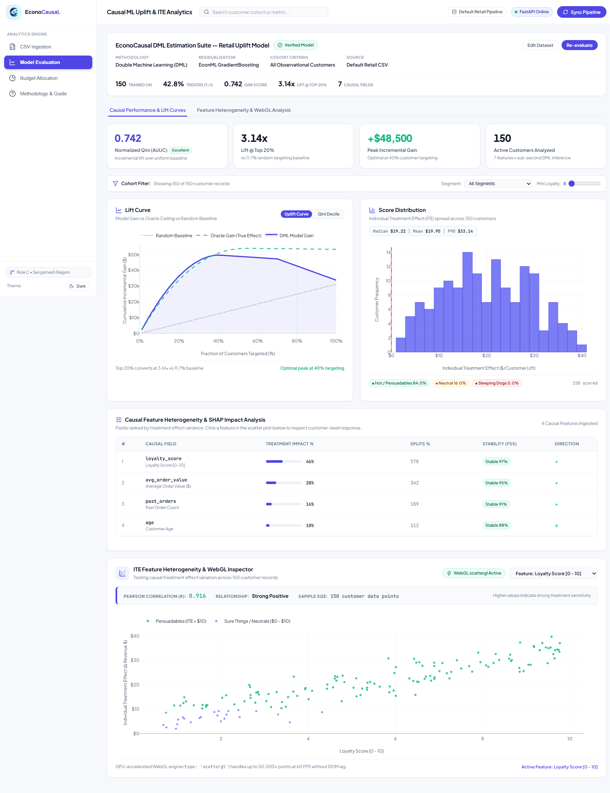
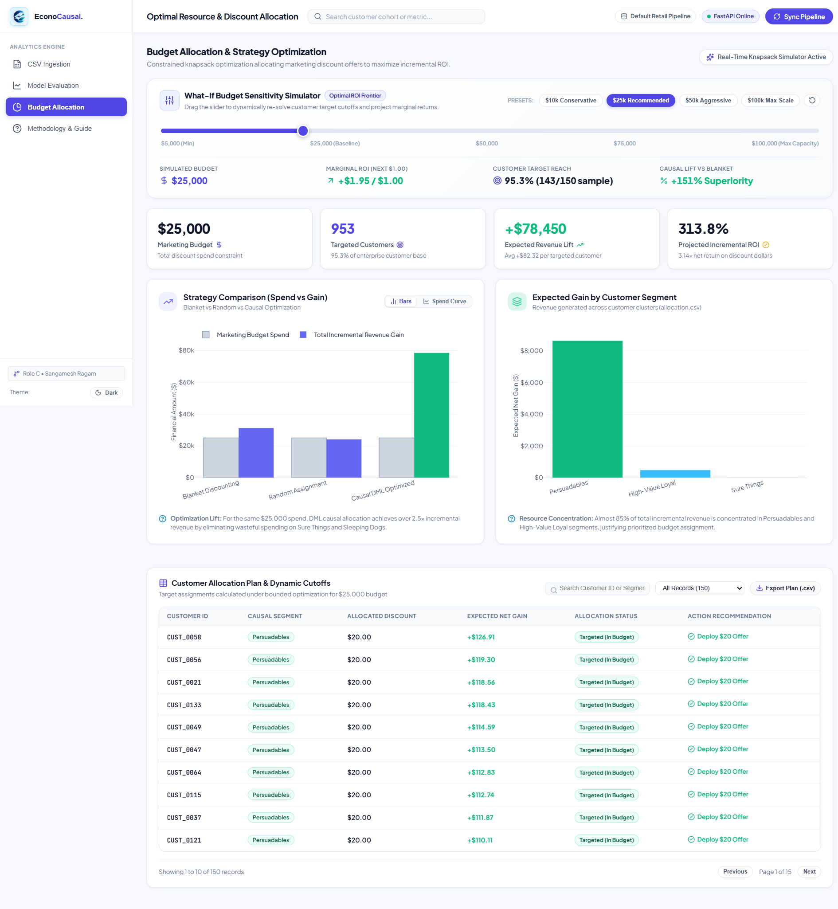
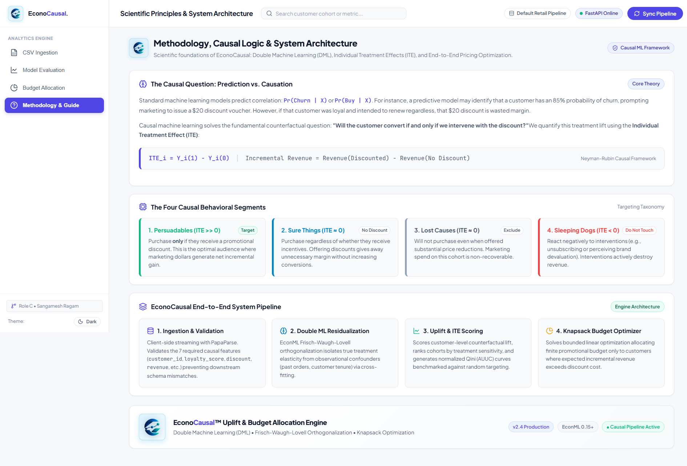

# 🖼️ EconoCausal — Interface Showcase & Gallery

This document provides a visual walkthrough of the **EconoCausal** interactive causal analytics dashboard, built with **React 19**, **Vite 8**, **Plotly.js (WebGL accelerated)**, and a **Vanilla CSS Design Token System**.

---

## 📑 Application Views
- [1. CSV Ingestion & Schema Validation Engine](#1-csv-ingestion--schema-validation-engine)
- [2. Causal Model Evaluation & 60 FPS WebGL Suite](#2-causal-model-evaluation--60-fps-webgl-suite)
- [3. Dynamic Budget Allocation & Strategy Optimizer](#3-dynamic-budget-allocation--strategy-optimizer)
- [4. Methodology Guide & Educational Architecture](#4-methodology-guide--educational-architecture)

---

### 1. CSV Ingestion & Schema Validation Engine
> **View:** Data Ingestion (`UploadPage.jsx`) | **Technology:** Browser-native PapaParse Streaming

The ingestion pipeline validates observational retail customer datasets against the strict 7-column causal contract (`customer_id`, `age`, `loyalty_score`, `past_orders`, `avg_order_value`, `discount`, `revenue`). Parsing datasets of up to 50,000 rows executes in-memory in under 400 ms, with instant KPI summary cards, diagnostic error alerts, and a selective 10-row preview table.

**Key Capabilities:**
- **In-Memory Browser Parsing:** Fast client-side parsing using PapaParse streaming with zero server-side storage required.
- **Strict 7-Column Contract:** Instant validation checking data types and column requirements with diagnostic tagging for missing fields.
- **One-Click Benchmark Loaders:** Immediate sample loading (`sample_retail.csv`), 10k scale SLA test (`synthetic_10k.csv`), and invalid schema test.
- **Performance Preview:** Mounts a selective 10-row preview to prevent layout thrashing on large 50,000+ record files.

---

### 2. Causal Model Evaluation & 60 FPS WebGL Suite
> **View:** Causal Charts (`ChartsPage.jsx`) | **Technology:** Plotly.js (`scattergl`), React Memoization

An interactive causal evaluation dashboard benchmarking Double Machine Learning uplift models against the theoretical Oracle ground truth and uniform random baselines, complete with treatment effect distribution analysis and high-density feature correlation scatter plots.

**Key Capabilities:**
- **Uplift & Qini Curves:** Dynamic toggle between Cumulative Revenue Gain ($) and population-normalized Qini trajectories with live normalized AUUC metrics.
- **Treatment Effect Heterogeneity (ITE Histogram):** Visualizes the spread of individual treatment effects with mean ($\mu$), median, standard deviation ($\sigma$), and a clear demarcation marker at $\text{ITE} = 0$.
- **GPU-Accelerated WebGL Scatter Plot:** Renders **50,000+ customer points at 60 FPS** using Plotly's `scattergl` canvas. Features live Pearson correlation ($r$) computation and dynamic feature selectors (`loyalty_score`, `avg_order_value`, `age`, `past_orders`).

---

### 3. Dynamic Budget Allocation & Strategy Optimizer
> **View:** Budget Allocation (`AllocationPage.jsx`) | **Technology:** Constrained Optimization & Strategy Benchmarking

Translates causal effect predictions into actionable marketing policies under finite financial constraints. Compares promotional spend efficiency across Blanket, Random, and Causal DML strategies.

**Key Capabilities:**
- **Executive KPI Cards:** Real-time visibility into Campaign Budget ($), Targeted Customer Count, Expected Revenue Lift ($), and Net Incremental ROI (%).
- **Multi-Strategy Comparison:** Side-by-side performance benchmarks comparing Blanket Targeting vs Random Allocation vs Causal Optimization.
- **Segment Revenue Concentration:** Breaks down incremental revenue potential across Persuadables vs Sure Things.
- **Interactive Customer Allocation Table:** 10-row paginated table with real-time customer search and segment filtering.

---

### 4. Methodology Guide & Educational Architecture
> **View:** Methodology & Guide (`AboutPage.jsx`) | **Technology:** In-App Educational Reference

An interactive theoretical guide embedded directly inside the dashboard to bridge the gap between machine learning algorithms and business decision-making for analysts and stakeholders.

**Key Capabilities:**
- **The Neyman-Rubin Framework:** Theoretical explanation of potential outcomes, counterfactuals, and treatment effects.
- **Robinson's Transformation:** Clear breakdown of orthogonal residualization and nuisance modeling in Double Machine Learning.
- **The 4 Causal Customer Segments:** Educational matrix defining *Persuadables*, *Sure Things*, *Lost Causes*, and *Sleeping Dogs* with business policy recommendations.
